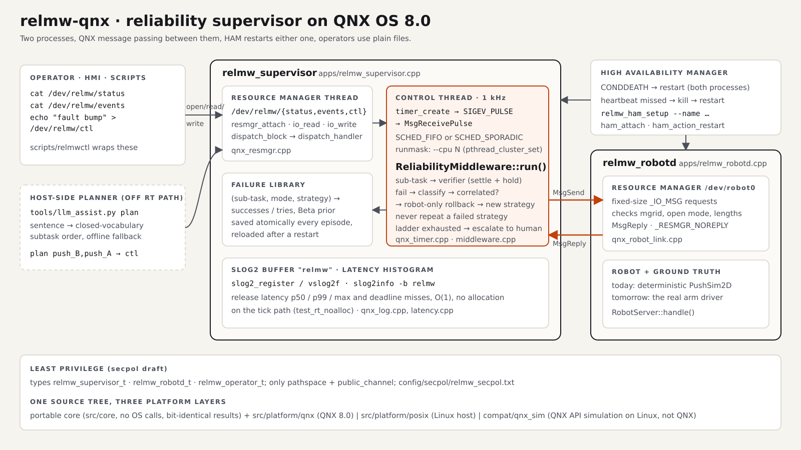

# relmw-qnx — a real-time reliability supervisor for robot manipulation on QNX 8.0

> **Status (2026-11-18 — S+ Release for QNX Global Hackathon · Robotics & Medical):**
> The portable C++17 core, 1 kHz Simplex physical safety shield, zero-dependency Tiny-MLP neural policy (FP32 + Q12),
> 128-byte CRC-32 telemetry & ROS 2 bridge, dual-screen replay dashboard, and **39 automated test suites** (22 Host +
> 17 `RELMW_QNX_SIM`) build with `-std=c++17 -O2 -Wall -Wextra -Werror` and pass 100%. The QNX 8.0 native layer
> (`src/platform/qnx/`) passes `-D__QNX__ -fsyntax-only -Wall -Wextra -Werror` against transcribed QNX SDP 8.0 API
> stubs (12 translation units + 9 negative rejection self-tests) and runs end-to-end through `compat/qnx_sim/`, but
> **has not yet been cross-compiled with `qcc`/`q++` or booted on a live QNX 8.0 QEMU/hardware target** — live QEMU
> evidence will be captured under `results/qnx_qemu_x86_64/` via `scripts/run_qnx80_evidence_pack.sh` once QNX SDP 8.0
> is installed. Nothing in this README claims QNX target numbers that are not in the repository.



## What it does
Learned robot policies fail in the long tail, and their failures are **correlated**: after a plain
rollback the robot sees almost the same situation and repeats the same mistake. `relmw` wraps *any*
policy with:

1. **Task decomposition** into subtasks, each with an independent **verifier** (camera-style estimate,
   0.5 cm safety margin) and a settle/hold check.
2. **Failure classification** (lost contact, wrong-side stall, stopped short, off-axis drift,
   unrecoverable, regressed) and **correlation fingerprinting** (same mode + same end pose = repeat).
3. **Robot-only rollback** (the world is not reset) and **strategy selection from a failure library**
   (posterior P(success | subtask, mode, strategy) with an engineer's prior), never repeating a strategy
   that already failed, **escalating to a human** when the ladder is exhausted, and applying persistent
   fixes pro-actively to later subtasks (shared cause).
4. A **final postcondition re-check** (later subtasks can disturb earlier ones).

On QNX it runs as a **real-time supervisor process**:

| QNX 8.0 feature | Where |
|---|---|
| Kernel timer → **pulse** → `MsgReceivePulse` control loop on a private channel (`ChannelCreate(_NTO_CHF_PRIVATE)`, `MsgRegisterEvent`) | `src/platform/qnx/qnx_timer.cpp` `PeriodicTimer` |
| **Resource manager** `/dev/relmw/{status,events,ctl}` (`cat` the state, `echo` commands) | `src/platform/qnx/qnx_resmgr.cpp` |
| **slog2** event log (`slog2info -b relmw`) | `src/platform/qnx/qnx_log.cpp` |
| **SCHED_FIFO / SCHED_SPORADIC** control thread | `qnx_timer.cpp` `set_thread_sched()` |
| **High Availability Manager**: restart on death; heartbeat entity whose missed-heartbeat condition kills a hung process so the restart takes over; failure library saved atomically and reloaded | `apps/relmw_ham_setup.cpp`, `qnx_timer.cpp` `watchdog_attach()`, `apps/relmw_supervisor.cpp` |
| **Robot driver as its own resource manager** `/dev/robot0`: fixed-size `_IO_MSG` requests over `MsgSend`/`MsgReply`; if the driver dies the supervisor reconnects and re-runs the episode (process-level recovery on top of task-level rollback) | `src/platform/qnx/qnx_robot_link.cpp`, `apps/relmw_robotd.cpp`, `src/core/robot_link.cpp` |
| CPU affinity of the control thread by cluster (`--cpu N` / `--cluster NAME`: `pthread_cluster_set`, runmask read back with `ThreadCtl`) | `qnx_timer.cpp` `set_thread_cluster()` |
| Security policy draft (least privilege per process type) + host-side lint | `config/secpol/relmw_secpol.txt`, `docs/secpol.md`, `tools/secpol_lint.py` |
| Release-latency histogram (p50/p99/max, deadline misses) | `src/platform/latency.cpp`, `relmw_supervisor --report` |
| **1 kHz Simplex Physical Safety Shield** (O(1) Control Barrier Projection, velocity/accel clamping, circular & convex-polygonal surgical No-Go Virtual Fixtures, `SHIELD_INTERVENTION` pulse counter, **0 heap allocations**) | `include/relmw/safety_shield.hpp`, `src/core/safety_shield.cpp` |
| **Zero-dependency C++17 Tiny-MLP Neural Policy** (`8 -> 32 -> 32 -> 2`, 1,410 trained BC+DAgger parameters in both IEEE `float32` and FPU-free `int16` Q12 fixed-point, **0 heap allocations**) | `include/relmw/nn_policy.hpp`, `include/relmw/nn_policy_weights.hpp`, `src/core/nn_policy.cpp`, `tools/train_nn_policy.py` |
| **128-byte Zero-Copy Binary Telemetry & ROS 2 / UDP Bridge + Dual-Screen Replay Dashboard** (IEEE CRC-32 `TelemetryFrame`, live trajectory replay of surgical No-Go boundary slide + `kill -9 relmw_robotd` self-healing) | `include/relmw/telemetry_bridge.hpp`, `src/core/telemetry_bridge.cpp`, `tools/ros2_qnx_bridge.py`, `docs/dashboard.html` |
| **One-click QNX SDP 8.0 QEMU Evidence Packager** (`qcc`/`q++` cross-build, SMP QEMU boot, 5-way 1 kHz RT tests, `tracelogger` `.kev`, HAM crash recovery & SHA-256 tarball) | `scripts/run_qnx80_evidence_pack.sh`, `scripts/target/relmw_target_run.sh` |

## Results so far (Linux host, simulation only)
Deterministic C++ 2-D push simulator, scripted policy, N = 100 paired episodes per arm (same seeds),
failure library warmed on 40 held-out seeds and frozen. Field condition = per-episode injected fault
(bump 25 %, perception bias 25 %, slippery 20 %, none 30 %). Full output: `results/host_linux/`.

| condition | no middleware | naive retry | relmw (correlation-aware) |
|---|---|---|---|
| nominal | 100/100 | 100/100 | 100/100 |
| field | 78/100 | 80/100 | **98/100** (95 % CI 93.0–99.4 %; vs. none +20 pts, McNemar p = 1.9e-6) |

Perception-bias episodes: 0/21 without middleware, 1/21 with naive retry, 19/21 with relmw
(fixed by the `relocalize` strategy, then applied pro-actively to the next subtask).
The verifier had 0 false positives against ground truth. These are simulation numbers, not robot data.

The results are bit-identical between a GCC/libstdc++ build and a Clang/libc++ build (the simulator and
statistics use a self-contained xoshiro256** RNG, not `<random>` distributions).

Real-time baseline on the Linux host (1 kHz, 30 episodes, `SCHED_OTHER` — `SCHED_FIFO` needs privileges the
host does not grant; shared 8-core machine):

| run | p50 | p99 | p99.9 | max | releases later than 500 µs |
|---|---|---|---|---|---|
| shared machine | 60 µs | 262 µs | 655 µs | 3.1 ms | 9 / 8067 |
| + 2 busy loops | 54 µs | 1.08 ms | 4.98 ms | 19.3 ms | 79 / 4536 |

Sources: `results/host_linux/rt_report_sched_other_1khz*.json`; all results in one page: `docs/dashboard.html`.

## Build and run (Linux host)
```bash
scripts/build_host.sh                     # CMake + Ninja, then ctest (18 tests, zero warnings with g++ 14.2)
build-host/relmw_bench --n 100 --out results/host_linux
build-host/relmw_supervisor --episodes 0 --period-us 1000 --sched other --mount /tmp/relmw --library /tmp/lib.txt &
scripts/relmwctl -m /tmp/relmw status
scripts/relmwctl -m /tmp/relmw fault percep_bias      # prints "OK fault percep_bias"
scripts/relmwctl -m /tmp/relmw events 10
scripts/relmwctl -m /tmp/relmw plan push_B,push_A    # subtask order from the next episode ("OK plan push_B,push_A")
python3 tools/llm_assist.py plan "push the blue cube first, then the red one"   # host-side LLM, falls back offline
scripts/relmwctl -m /tmp/relmw quit
python3 tools/make_dashboard.py --host results/host_linux --out docs/dashboard.html
```

Tests (`ctest`): unit tests for rng, stats, sim2d, middleware, retry_policy, latency, POSIX platform,
end-to-end experiment (70 cases), a real-time no-allocation test (`test_rt_noalloc`: record/step/get_obs/
wait_tick/now_ns allocate nothing; a whole episode allocates 0.04 times per tick, only at sub-task boundaries),
a supervisor end-to-end test (control surface, `relmwctl`, `--cpu 0`, `plan`, library survives a restart),
the robot-link tests (protocol layout, remote == in-process for 30 seeds x 3 arms, `relmw_robotd` crash recovery),
CPU-affinity and plan unit tests, the QNX syntax check, and the dashboard / LLM-assistant / secpol-lint tests.

## QNX code checks available before the SDP
```bash
scripts/qnx_syntax_check.sh    # g++ -fsyntax-only -D__QNX__ against tools/qnx_stubs (8.0 signatures) + stub self-test
```

### Run the QNX code path on Linux — QNX API simulation on Linux, not QNX
`compat/qnx_sim/` simulates, in user space, the QNX 8.0 calls relmw uses (channels, `MsgSend/MsgReceive/MsgReply`,
pulses, `timer_create` → pulse, a minimal resource manager and slog2), so the same `#ifdef __QNX__` sources compile, link
and run end to end on Linux:
```bash
cmake -G Ninja -S . -B build-sim -DRELMW_QNX_SIM=ON && cmake --build build-sim
ctest --test-dir build-sim     # 14 tests: simulated-API unit tests, /dev/relmw via relmwctl, relmw_robotd remote ==
                               # in-process + crash recovery, bench byte-identical to results/host_linux
```
Binaries built this way report `QNX API simulation on Linux (not QNX)` in `status`, slog2 and stdout. **They are not QNX
measurements**: no priority inheritance, no kernel blocking states, no secure-event validation, no secpol, no HAM, and
the timer is a Linux thread. See `compat/qnx_sim/README.md` for the full list of differences with links to the 8.0 docs.

## Build and run (QNX SDP 8.0, QEMU x86_64) — to be validated
One command after the SDP is installed (build → image → boot → tests, bench, RT runs, resmgr demo, slog2, HAM → collect):
```bash
QNX_SDP=~/qnx800 scripts/qnx_first_run.sh --preflight   # checks prerequisites only
QNX_SDP=~/qnx800 scripts/qnx_first_run.sh               # logs in results/qnx_qemu_x86_64/first_run_<UTC>/
```
Individual steps:
```bash
QNX_SDP=~/qnx800 scripts/build_qnx.sh x86_64     # qcc/q++ via cmake/qnx-x86_64.cmake
QNX_SDP=~/qnx800 scripts/qemu_image.sh           # mkqnximage --type=qemu --arch=x86_64 --run
TARGET=root@<qemu-ip> scripts/deploy_qemu.sh     # copies binaries, runs bench + supervisor, fetches results
# on the target:
cat /dev/relmw/status
echo "fault percep_bias" > /dev/relmw/ctl
slog2info -b relmw
```
QNX version: QNX SDP 8.0 (QNX Everywhere non-commercial license). Target: QEMU x86_64 (aarch64le toolchain
file provided for Raspberry Pi 5). Toolchain: qcc/q++ (`gcc_ntox86_64`).

## Layout
See `docs/architecture.svg`, `docs/dashboard.html` and the header comments in `include/relmw/*.hpp`. The core (`src/core`) has no OS
calls and is shared by both platforms; QNX-specific code is isolated under `#ifdef __QNX__`.

## Provenance
The algorithm comes from our earlier Python/MuJoCo prototype (before 2026-11-02). Every file in this
repository was written during the hackathon submission period (first commit 2026-11-10).

## License
Apache-2.0 (see `LICENSE` and `NOTICE`). Copyright (c) 2026 Qidianyan / ELIDOT AI. Vendored Phosphor Icons (`tools/dashboard_assets/phosphor/`) remain under MIT.
