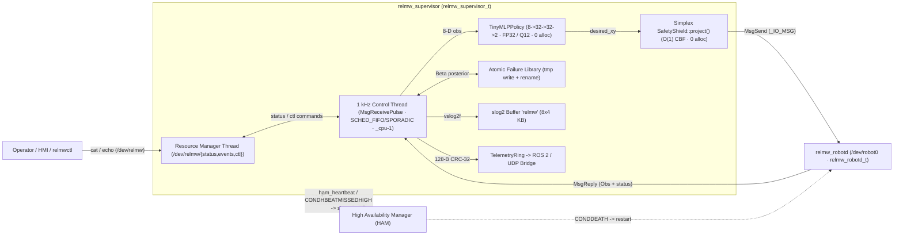

# Build a 1 kHz Zero-Allocation Simplex Safety Supervisor on QNX OS 8.0

> **Codelab Overview:** In 6 hands-on steps (~60 minutes), you will build, inspect, test, and harden **`relmw-qnx`** — a real-time Runtime Assurance (Simplex) safety shield and correlation-aware reliability supervisor for Physical AI robot manipulation on **QNX OS 8.0**.  
> **Companion Assets:** [Interactive Web Codelab (`index.html`)](index.html) · [Live Results & Dual-Screen Replay Dashboard (`../dashboard.html`)](../dashboard.html) · [Architecture Diagram (`../architecture.svg`)](../architecture.svg) · [Demo Video (`2m 41s`, YouTube)](https://youtu.be/kLAHQDBODiU) · [Source Repository](https://github.com/Qidianyan/relmw-qnx)

| Track | Duration | Target Platforms | Language & Tooling |
| :--- | :---: | :--- | :--- |
| QNX OS 8.0 Real-Time Systems · Robotics & Medical | **60 min** (6 × 10 min) | QNX SDP 8.0 (`x86_64` QEMU / `aarch64le` Raspberry Pi 5) + POSIX / `RELMW_QNX_SIM` host rehearsal | C++17 (`qcc`/`q++`, `clang++`/`g++`), CMake/Ninja or `build_direct.sh`, Python 3 |

> **Engineering Honesty Notice:** Every host and `RELMW_QNX_SIM` output shown in this Codelab comes from real compiled runs of `https://github.com/Qidianyan/relmw-qnx` (`-std=c++17 -O2 -Wall -Wextra -Werror`). The robot plant is a deterministic 2-D contact-push simulator (`src/core/sim2d.cpp`), not physical hardware. `compat/qnx_sim/` (**QNX API simulation on POSIX host**) compiles and executes the real `#ifdef __QNX__` platform files to prove control-flow and IPC logic, **never** QNX kernel latency or hardware security enforcement. Live QNX SDP 8.0 QEMU latency, `tracelogger` `.kev` traces, and `secpolcompile` outputs are marked **`[Run on QNX SDP 8.0 Target]`** and generated automatically by `scripts/run_qnx80_evidence_pack.sh` on any host with QNX SDP 8.0 installed.

---

## Why This Architecture Matters on QNX OS 8.0

Learned neural manipulation policies fail in **correlated** ways: if a wrist camera has a static bias, blindly rolling back and retrying reproduces the exact same failure — and in surgical or sterile pharmacy cells, naive retries repeatedly drive the end-effector through forbidden keep-out zones (**1,345 intrusions across 100 episodes** in our paired benchmark, 1.77× worse than not retrying at all).

Rather than burying safety inside a monolithic Linux robotics process, **`relmw-qnx`** maps Runtime Assurance onto the native primitives of the **QNX OS 8.0 microkernel**:



*(Full high-resolution vector diagram: [`docs/architecture.svg`](../architecture.svg).)*

### 6-Step Codelab Roadmap

| Step | Duration | Focus Area | Primary QNX OS 8.0 APIs & Repo Files |
| :---: | :---: | :--- | :--- |
| **Step 1** | 10 min | Dual-Target Build, `RELMW_QNX_SIM` & Strict QNX 8.0 Syntax Gate | `scripts/build_direct.sh`, `scripts/qnx_syntax_check.sh`, `compat/qnx_sim/`, `tests/test_rt_noalloc.cpp` |
| **Step 2** | 10 min | 1 kHz Kernel-Timer Pulse Loop, `SCHED_SPORADIC` & Cluster Pinning | `ChannelCreate(_NTO_CHF_PRIVATE)`, `MsgRegisterEvent`, `MsgReceivePulse`, `pthread_cluster_set` (`src/platform/qnx/qnx_timer.cpp`) |
| **Step 3** | 10 min | Zero-Alloc Simplex Safety Shield (CBF) & `TinyMLPPolicy` | `SafetyShield::project() noexcept`, `SafetyEnvelope::medical_surgical_fixture()`, `TinyMLPPolicy` (`src/core/safety_shield.cpp`, `src/core/nn_policy.cpp`) |
| **Step 4** | 10 min | POSIX-Path Resource Managers (`/dev/relmw` & `/dev/robot0`) | `resmgr_attach`, `iofunc_func_init`, `resmgr_msgget`, `_IO_MSG`, `MsgSend`/`MsgReply` (`qnx_resmgr.cpp`, `qnx_robot_link.cpp`) |
| **Step 5** | 10 min | Dual-Layer `HAM` Self-Healing, `slog2` & 128-B ROS 2 Telemetry | `ham_attach`, `ham_attach_self`, `ham_condition`, `slog2_register`, `vslog2f`, `TelemetryFrame` (`relmw_ham_setup.cpp`, `qnx_log.cpp`, `ros2_qnx_bridge.py`) |
| **Step 6** | 10 min | Least-Privilege `secpol` Hardening & QNX 8.0 QEMU / RPi 5 Deployment | `config/secpol/relmw_secpol.txt`, `tools/secpol_lint.py`, `scripts/run_qnx80_evidence_pack.sh`, `tracelogger` |

### Prerequisites
- **Steps 1–6 (Host + `RELMW_QNX_SIM` rehearsal):** Linux or macOS with a C++17 compiler (`clang++` or `g++ >= 11`), POSIX `sh`/`bash`, and Python 3 (`>= 3.9`, zero third-party packages required). CMake + Ninja are optional (`scripts/build_direct.sh` compiles with zero external build tools).
- **Step 6 (Live QNX 8.0 Target Execution):** Free non-commercial **QNX Everywhere** license ([qnx.software](https://qnx.software/)), QNX Software Center, **QNX SDP 8.0** (`~/qnx800`), the **QEMU Quick Start Target Image (`mkqnximage`)** or **Raspberry Pi 5 QSTI**, and the **High Availability Manager (HAM)** package.

---

## Step 1 — Workspace Setup, Dual-Target Build & Strict QNX 8.0 Syntax Gate

**Duration:** `0:10`

### 1.1 Repository Layout
`relmw-qnx` isolates OS-independent control and safety math from QNX 8.0 system calls so the same C++17 core compiles cleanly across POSIX hosts, `RELMW_QNX_SIM`, and QNX SDP 8.0 (`qcc`/`q++`):

| Directory | Contents | OS Calls? |
| :--- | :--- | :---: |
| `src/core/` & `include/relmw/` | `SafetyShield` (CBF), `TinyMLPPolicy` (FP32 + Q12), `ReliabilityMiddleware`, `Verifier`, `FailureLibrary`, `TelemetryRing`, deterministic `PushSim2D` (`xoshiro256**`) | **None** |
| `src/platform/qnx/` | Native QNX OS 8.0 pulse timer, `SCHED_FIFO`/`SCHED_SPORADIC`, cluster affinity, `/dev/relmw` resmgr, `/dev/robot0` `_IO_MSG` driver link, `slog2`, `HAM` heartbeat | **QNX 8.0 (`#ifdef __QNX__`)** |
| `src/platform/posix/` | Linux/macOS baseline (`clock_nanosleep`, FIFO control surface, `AF_UNIX` `SOCK_SEQPACKET` robot link) | POSIX |
| `compat/qnx_sim/` | User-space QNX 8.0 API rehearsal (`-DRELMW_QNX_SIM=ON`): compiles and executes `src/platform/qnx/*.cpp` on POSIX hosts (explicitly labelled as simulation, never QNX timing) | POSIX |
| `apps/` | `relmw_supervisor`, `relmw_robotd`, `relmw_bench`, `relmw_ham_setup` | Via platform layer |

### 1.2 Clone, Compile (`-Wall -Wextra -Werror`) & Run All 39 Test Suites
Run the zero-dependency direct builder (compiles both `build-host` and `build-sim` with `-std=c++17 -O2 -Wall -Wextra -Werror`):

```bash
git clone https://github.com/Qidianyan/relmw-qnx.git
cd relmw-qnx

# Build & run all 22 Host tests + all 17 RELMW_QNX_SIM tests (39/39 total)
CXX=clang++ bash scripts/build_direct.sh all
```

*(If you prefer CMake + Ninja on Linux:)*

```bash
scripts/build_host.sh
cmake -G Ninja -S . -B build-sim -DRELMW_QNX_SIM=ON && cmake --build build-sim
ctest --test-dir build-sim --output-on-failure
```

### 1.3 Run the Strict QNX SDP 8.0 Static Syntax & Negative-Stub Gate
Before installing SDP 8.0, `scripts/qnx_syntax_check.sh` parses every QNX 8.0 translation unit with `-std=c++17 -fsyntax-only -Wall -Wextra -Werror -D__QNX__` against clean-room QNX 8.0 header signatures (`tools/qnx_stubs/include/`), bans discontinued `__QNXNTO__` macros, and executes **9 negative self-tests** proving wrong QNX API calls are rejected:

```bash
CXX=g++ bash scripts/qnx_syntax_check.sh
```

Expected output (verified):

```console
OK    src/platform/qnx/qnx_timer.cpp
OK    src/platform/qnx/qnx_log.cpp
OK    src/platform/qnx/qnx_resmgr.cpp
OK    src/platform/qnx/qnx_robot_link.cpp
OK    src/platform/latency.cpp
OK    src/core/robot_link.cpp
OK    src/core/safety_shield.cpp
OK    src/core/nn_policy.cpp
OK    src/core/telemetry_bridge.cpp
OK    apps/relmw_supervisor.cpp
OK    apps/relmw_ham_setup.cpp
OK    apps/relmw_robotd.cpp
OK    stub rejects: ham_attach() with 4 args
OK    stub rejects: resmgr_attach() missing handle
OK    stub rejects: slog2_register() with 2 args
OK    stub rejects: unknown sched_param member
OK    stub rejects: MsgReceivePulse() with 3 args
OK    stub rejects: MsgReply() without status
OK    stub rejects: io_funcs.msg with a devctl-style handler
OK    stub rejects: pthread_cluster_set() without tid
OK    stub rejects: pthread_cluster_get_runmask() with unsigned*
qnx_syntax_check: all QNX translation units pass -fsyntax-only against 8.0 stubs
```

### Verification Checkpoint 1
Run both zero-allocation proofs and check bit-exact determinism across platforms:

```bash
./build-host/test_rt_noalloc
./build-sim/test_rt_noalloc
```

- **PASS criteria:** Both binaries report `10 cases, 0 failed` (`0` heap allocations on `LatencyStats::record`, `PushSim2D::step`, `PeriodicTimer::wait_tick`, `RemoteRobot::step`, `SafetyShield::project`, `TinyMLPPolicy::act`, and `TelemetryRing::emit`), and `build_direct.sh all` finishes with `ALL 22 HOST TESTS PASSED` and `ALL 17 QNX_SIM TESTS PASSED`.

---

## Step 2 — Deterministic 1 kHz Kernel-Timer Pulse Loop (`MsgReceivePulse`, `SCHED_SPORADIC` & Cluster Pinning)

**Duration:** `0:10`

### 2.1 Private Channel + Secure Pulse Event (`src/platform/qnx/qnx_timer.cpp`)
In QNX OS 8.0, a hard real-time 1 kHz control thread avoids asynchronous POSIX signals (which break lock safety) and sleep polling. Instead, it creates a **private channel** (`_NTO_CHF_PRIVATE`), attaches a side-channel connection to itself, binds a `CLOCK_MONOTONIC` kernel timer to a `SIGEV_PULSE`, secures the event with `MsgRegisterEvent(..., SYSMGR_COID)` so only the process manager can deliver it, and blocks in `MsgReceivePulse()`:

```cpp
// src/platform/qnx/qnx_timer.cpp (lines 43–81, 90–107)
impl_->chid = ChannelCreate(_NTO_CHF_PRIVATE);
impl_->coid = ConnectAttach(0, 0, impl_->chid, _NTO_SIDE_CHANNEL, 0);

// Query the control thread's CURRENT priority AFTER set_thread_sched()!
struct sched_param cur;
int cur_policy = SCHED_OTHER;
int prio = 10;
if (pthread_getschedparam(pthread_self(), &cur_policy, &cur) == EOK)
  prio = cur.sched_priority;

struct sigevent ev;
SIGEV_PULSE_INIT(&ev, impl_->coid, prio, kPulseTick, 0);
MsgRegisterEvent(&ev, SYSMGR_COID);           // secure event delivery
timer_create(CLOCK_MONOTONIC, &ev, &impl_->timer);

struct itimerspec its{};
nsec2timespec(&its.it_value, (uint64_t)period_ns);
nsec2timespec(&its.it_interval, (uint64_t)period_ns);
next_release_ = now_ns() + period_ns;
timer_settime(impl_->timer, 0, &its, nullptr);

// Inside PeriodicTimer::wait_tick() — O(1), 0 heap allocations:
struct _pulse p;
for (;;) {
  if (MsgReceivePulse(impl_->chid, &p, sizeof p, nullptr) == -1) {
    if (errno == EINTR) continue;
    return -1;
  }
  if (p.code == kPulseStop) return -1;
  if (p.code != kPulseTick) continue;
  std::int64_t t = now_ns();
  std::int64_t late = t - next_release_;
  next_release_ += period_;
  while (next_release_ <= t - period_) next_release_ += period_;
  return late < 0 ? 0 : late;
}
```

> **Critical QNX 8.0 Pitfall — Never Pass `SIGEV_PULSE_PRIO_INHERIT` Here!**  
> Per the QNX SDP 8.0 `sigevent` specification, `SIGEV_PULSE_PRIO_INHERIT` sets the receiving thread to the **process's initial priority**, not the thread's elevated real-time priority. A control thread raised to `SCHED_FIFO` priority `40` would silently demote to default priority `10` on every 1 ms tick! Always call `set_thread_sched()` **first**, read back `cur.sched_priority` with `pthread_getschedparam()`, and pass that explicit priority to `SIGEV_PULSE_INIT()`.

### 2.2 `SCHED_SPORADIC` Budgeted Server & QNX 8.0 Cluster Pinning
To ensure a buggy or runaway control loop can never starve system services or HAM, `set_thread_sched()` supports **`SCHED_SPORADIC`** alongside `SCHED_FIFO` and validates all three kernel constraints before calling `pthread_setschedparam()`:

```cpp
// src/platform/qnx/qnx_timer.cpp (lines 120–136)
if (low_priority >= priority || budget_ns <= 0 || budget_ns >= period_ns) {
  if (err) *err = "sporadic needs low_priority < priority and 0 < budget < period";
  return false;
}
pol = SCHED_SPORADIC;
sp.sched_ss_low_priority = low_priority;          // e.g. 10 (< 40)
nsec2timespec(&sp.sched_ss_init_budget, (uint64_t)budget_ns);   // e.g. 500 us
nsec2timespec(&sp.sched_ss_repl_period, (uint64_t)period_ns);   // 1000 us
sp.sched_ss_max_repl = 4;                         // < SS_REPL_MAX
sp.sched_priority = priority;                     // e.g. 40 (<= 63 unprivileged)
pthread_setschedparam(pthread_self(), pol, &sp);
```

To isolate the 1 kHz control thread on its own core without pinning the non-RT resource manager thread, `set_thread_cluster()` uses QNX 8.0's cluster API and reads back the active runmask with `ThreadCtl`:

```cpp
// src/platform/qnx/qnx_timer.cpp (lines 144–167)
uint64_t mask = 0;
if (pthread_cluster_get_runmask(name.c_str(), &mask) != EOK) return false;
pthread_cluster_set(0, name.c_str());             // e.g. "_cpu-1" (control thread only)
unsigned int rm = 0;
ThreadCtl(_NTO_TCTL_RUNMASK_GET_AND_SET, &rm);    // rm == 0 reads mask without modifying it
```

### 2.3 Real-Time Release-Latency Baseline (Host vs QNX 8.0 Target)
Every tick's release lateness (`t - next_release_`) is recorded into an O(1), zero-allocation log-bucketed histogram (`src/platform/latency.cpp`, deadline = `period / 2` = `500 µs`).

| Platform & Condition | Scheduler | p50 | p99 | p99.9 | Max | Misses (`> 500 µs`) |
| :--- | :--- | :---: | :---: | :---: | :---: | :---: |
| Linux Host (shared 8-core, idle) | `SCHED_OTHER` | `60.4 µs` | `262.1 µs` | `655.4 µs` | `3,138.5 µs` | `9 / 8,067` |
| Linux Host (+ 2 busy loops) | `SCHED_OTHER` | `54.3 µs` | `1,081.3 µs` | `4,980.7 µs` | **`19,263.4 µs`** | **`79 / 4,536`** |
| QNX OS 8.0 (QEMU x86_64, 4 vCPU) | `SCHED_FIFO 40` + `_cpu-1` | `[Run on QNX SDP 8.0 Target]` | — | — | — | — |
| QNX OS 8.0 (QEMU x86_64, +2 busy loops) | `SCHED_SPORADIC 40/10` | `[Run on QNX SDP 8.0 Target]` | — | — | — | — |

*(Use the **Interactive Timing & `SCHED_SPORADIC` Budget Verifier** in [`index.html#step-2`](index.html#step-2) to inspect these JSON histograms or paste your own QNX 8.0 `rt_report_*.json`.)*

### Verification Checkpoint 2
```bash
./build-host/test_latency
./build-host/test_affinity
./build-sim/test_qnx_sim
```

- **PASS criteria:** `test_latency` (`7 cases, 0 failed`), `test_affinity` (`3 cases, 0 failed`), and `test_qnx_sim` (`7 cases, 0 failed`, verifying pulse delivery, periodic grid alignment, and `pthread_cluster` runmask readback).

---

## Step 3 — 1 kHz Zero-Allocation Simplex Safety Shield (CBF) & `TinyMLPPolicy`

**Duration:** `0:10`

### 3.1 Simplex Runtime Assurance Pipeline
Inside every 1 ms tick, **`relmw-qnx`** runs an untrusted learned neural policy behind a deterministic, mathematically bounded **Simplex Safety Shield**:

1. **Complex Controller (`include/relmw/nn_policy.hpp`, `src/core/nn_policy.cpp`):**  
   `TinyMLPPolicy` (`8 -> 32 (ReLU) -> 32 (ReLU) -> 2`, **1,410** static `constexpr` parameters trained via Behavior Cloning + 2 rounds of DAgger over `91,434` contact trajectories, SHA-256 prefix `9354f53ae9f4cfce`). Supports both IEEE `float32` (`forward_fp32`) and FPU-free `int16_t` `Q12` fixed-point (`forward_q12`, max deviation `0.814 mm`), executing in `< 2 µs` with **0 heap allocations**.
2. **Verified Safety Filter (`include/relmw/safety_shield.hpp`, `src/core/safety_shield.cpp`):**  
   `SafetyShield::project(Vec2 current_pos, Vec2 desired_target) noexcept` runs in O(1) time with stack-only memory:
   - **Stage A — Non-finite & Kinematic Envelope:** Rejects `NaN`/`Inf` targets (`kShieldNonFinite`, holding `current_pos`) and clamps single-tick displacement (`max_step_delta`) and acceleration (`max_step_accel`).
   - **Stage B — 3-Pass Supporting-Hyperplane CBF Projection:** Enforces workspace limits plus circular (`Circle 0`: vascular/ampoule hazard at `(0.045, -0.185) m`, `r = 2.2 cm`, `margin = 4 mm`) and CCW convex-polygonal (`Polygon 0`: sterile instrument tray `[0.010..0.070, 0.055..0.095] m`, `margin = 3 mm`) virtual fixtures:
     $$(p - c) \cdot n \ge (1 - \alpha)\, r_0 + \alpha\, r_{\text{eff}}, \qquad r_{\text{eff}} = r_{\text{zone}} + r_{\text{tool}} + m_{\text{margin}}$$
     Because the supporting half-space is tangent to the obstacle normal $n$, the entire continuous motion chord $[p_{\text{cur}}, p_{\text{safe}}]$ stays outside the hazard while preserving **tangential glide** along $n^\perp$ (with an anti-deadlock tangential nudge for dead-center rays).
   - **Stage C — Continuous-Chord Invariant & Pulse Hook:** Re-checks `segment_zone_clearance(current_pos, p, false) >= 0.0` (holding `current_pos` if opposing fixtures conflict in a corner) and invokes an allocation-free raw function pointer `ShieldPulseHook` (no `std::function`) to increment `SHIELD_INTERVENTION`.

```cpp
// src/core/safety_shield.cpp (lines 247–268) — Circular CBF Supporting Half-Space
const double r_eff = cz.radius + env_.tool_radius + cz.margin;
const Vec2 d0 = current_pos - cz.center;
const double r0 = d0.norm();
const Vec2 n = r0 > 1e-9 ? d0 * (1.0 / r0) : Vec2{0.0, 1.0};
const double rhs = (r0 >= r_eff) ? ((1.0 - alpha) * r0 + alpha * r_eff) : (r_eff + 0.002);
const double proj = (p - cz.center).dot(n);
if (proj < rhs) {
  p = p + n * (rhs - proj);
  const Vec2 tang = n.perp();
  if (std::fabs((p - current_pos).dot(tang)) < 0.004 && (desired_target - current_pos).norm() > 0.005) {
    const double sign = (desired_target - cz.center).dot(tang) >= 0.0 ? 1.0 : -1.0;
    p = p + tang * (0.012 * sign);
  }
  hit_circ = true;
}
```

### 3.2 Run the Paired S+ Medical Surgical-Fixture Benchmark
```bash
./build-host/relmw_bench --n 100 --warmup 40 --bias 0.12 \
  --policy mlp --preset medical_vial --shield \
  --export-replay results/host_splus/replay_showcase.bin \
  --out results/host_splus
```

Real measured output (`results/host_splus/summary.json`, `TinyMLPPolicy` FP32, `N = 100` paired unseen seeds `1000..1099`, failure library warmed on `40` held-out seeds and frozen):

| Condition | Arm (`N = 100` paired) | Task Success (95% Wilson CI) | Zero-Intrusion Rate | Total Zone Intrusions | Shield Pulses | Min True Clearance | Mean Sim Steps |
| :--- | :--- | :---: | :---: | :---: | :---: | :---: | :---: |
| Nominal | `single_pass` (no shield) | `100/100` (`96.3–100.0%`) | `0/100` (`0.0%`) | `741` | `0` | `-41.99 mm` | `97.55` |
| Nominal | `corr_aware_retry` (`relmw-qnx`) | **`100/100`** (`96.3–100.0%`) | **`100/100` (`100.0%`)** | **`0`** | `3,372` | **`+6.55 mm`** | `100.80` |
| Field Faults | `single_pass` (no shield) | `77/100` (`67.8–84.2%`) | `1/100` (`1.0%`) | `762` | `0` | `-41.91 mm` | `123.65` |
| Field Faults | `naive_retry` (no shield) | `78/100` (`68.9–85.0%`, `p = 1.0`) | `0/100` (`0.0%`) | **`1,345`** *(1.77× worse)* | `0` | `-41.91 mm` | `279.11` |
| Field Faults | **`corr_aware_retry` (`relmw-qnx`)** | **`92/100`** (**`+15.0 pp`**, McNemar **`p = 0.000275`**) | **`100/100` (`100.0%`)** | **`0`** | **`7,262`** | **`+3.00 mm`** | **`206.16`** (−26.1% vs naive) |

*(Classic `ScriptedPushPolicy` baseline in `results/host_linux/summary.json`: Field `78/100 -> 80/100 -> 98/100`, `+20.0 pp`, exact McNemar `p = 1.91e-6`, `0` verifier false positives.)*

### Verification Checkpoint 3
```bash
./build-host/test_safety_shield
./build-host/test_nn_policy
```

- **PASS criteria:** `test_safety_shield` (`6 cases, 0 failed`: NaN/Inf interception, kinematic clamping, circular + polygonal CBF tangential sliding, **2,000 adversarial rays with 0 penetrations**) and `test_nn_policy` (`4 cases, 0 failed`: FP32/Q12 parity, `77 -> 78 -> 92` paired uplift, `0/100` intrusions, 642-frame binary replay integrity).

---

## Step 4 — QNX 8.0 Resource Managers (`/dev/relmw` & Isolated `/dev/robot0` over `_IO_MSG`)

**Duration:** `0:10`

### 4.1 Operator Control Surface: `/dev/relmw/{status,events,ctl}` (`src/platform/qnx/qnx_resmgr.cpp`)
A QNX resource manager turns your supervisor into standard POSIX pathnames — any operator shell, HMI, or test harness can inspect state with `cat` and toggle policies or inject faults with `echo`:

```cpp
// src/platform/qnx/qnx_resmgr.cpp (lines 112–131)
impl_->dpp = dispatch_create();
iofunc_func_init(_RESMGR_CONNECT_NFUNCS, &impl_->connect_funcs,
                 _RESMGR_IO_NFUNCS, &impl_->io_funcs);
impl_->io_funcs.read    = relmw_io_read;
impl_->io_funcs.read64  = relmw_io_read;   // QNX 8.0 routes _IO_READ64 to read64
impl_->io_funcs.write   = relmw_io_write;
impl_->io_funcs.write64 = relmw_io_write;  // QNX 8.0 routes _IO_WRITE64 to write64

iofunc_attr_init(&impl_->attr_status, S_IFNAM | 0444, nullptr, nullptr);
iofunc_attr_init(&impl_->attr_events, S_IFNAM | 0444, nullptr, nullptr);
iofunc_attr_init(&impl_->attr_ctl,    S_IFNAM | 0666, nullptr, nullptr);

resmgr_attach(impl_->dpp, &rattr, "/dev/relmw/status", _FTYPE_ANY, 0, &connect_funcs, &io_funcs, &attr_status);
resmgr_attach(impl_->dpp, &rattr, "/dev/relmw/events", _FTYPE_ANY, 0, &connect_funcs, &io_funcs, &attr_events);
resmgr_attach(impl_->dpp, &rattr, "/dev/relmw/ctl",    _FTYPE_ANY, 0, &connect_funcs, &io_funcs, &attr_ctl);
```

Notice two QNX 8.0 security and consistency details in `qnx_resmgr.cpp`:
1. **Offset-0 atomic snapshot:** `relmw_io_read()` refreshes `snap_status` / `snap_events` only when `ocb->offset == 0`, so multi-chunk `cat` reads never see torn state.
2. **Message-length validation:** Before `resmgr_msgget()`, `relmw_io_write()` checks `nbytes > (size_t)ctp->info.srcmsglen - (size_t)ctp->offset - sizeof(io_write_t)` and rejects forged short messages with `EBADMSG`.

### 4.2 Process-Isolated Robot Driver: `/dev/robot0` (`src/platform/qnx/qnx_robot_link.cpp`)
Instead of linking the robot driver into the supervisor address space, `apps/relmw_robotd.cpp` runs as an isolated process exposing `/dev/robot0` via fixed-size synchronous `_IO_MSG` frames (`MsgSend` / `MsgReply`):

```cpp
// src/platform/qnx/qnx_robot_link.cpp (lines 61–75, 100–118)
int chid = ChannelCreate(_NTO_CHF_UNBLOCK | _NTO_CHF_DISCONNECT | _NTO_CHF_INHERIT_RUNMASK);
dispatch_t* dpp = dispatch_create_channel(chid, DISPATCH_FLAG_NOLOCK);
// _NTO_CHF_INHERIT_RUNMASK + QNX priority inheritance: driver handles each 1 kHz step
// at the supervisor's SCHED_FIFO priority AND on the supervisor's pinned CPU cluster!

int robot_io_msg(resmgr_context_t* ctp, io_msg_t* msg, RESMGR_OCB_T* ocb) {
  if (ctp->rcvid == 0) return ENOTSUP;                   // refuse combine messages
  if (msg->i.mgrid != kQnxRobotMgrId) return ENOSYS;     // _IOMGR_PRIVATE_BASE + 0x52
  if (!(ocb->ioflag & _IO_FLAG_WR)) return EPERM;        // _IO_MSG bypasses iofunc_*_verify!
  if (ctp->info.srcmsglen < ctp->offset + sizeof(RobotRequest)) return EBADMSG;
  if (ctp->info.dstmsglen < sizeof(RobotReply)) return EMSGSIZE;
  RobotRequest req;
  if (resmgr_msgget(ctp, &req, sizeof req, 0) < (ssize_t)sizeof req) return EBADMSG;
  RobotReply rep{};
  g_ctx.server->handle(req, sizeof req, rep);
  MsgReply(ctp->rcvid, EOK, &rep, sizeof rep);
  return _RESMGR_NOREPLY;
}
```

### 4.3 Hands-On Rehearsal (QNX API Simulation on Host vs Native QNX 8.0)

**Option A — Rehearse the exact `#ifdef __QNX__` code path locally (`RELMW_QNX_SIM=1`):**

```bash
export RELMW_QNX_SIM=1 QNXSIM_IO="$PWD/build-sim/qnxsim_io" QNXSIM_ROOT=/tmp/qnxsim-lab
rm -rf "$QNXSIM_ROOT" && mkdir -p "$QNXSIM_ROOT"

./build-sim/relmw_robotd --path /dev/robot0 &
ROBOTD_PID=$!
sleep 0.5
./build-sim/relmw_supervisor --episodes 0 --period-us 1000 --sched other \
  --preset medical_vial --policy mlp --shield \
  --robot /dev/robot0 --mount /dev/relmw --library /tmp/qnxsim-lib.txt &
SUP_PID=$!
sleep 1

scripts/relmwctl status
scripts/relmwctl fault percep_bias
scripts/relmwctl shield on
scripts/relmwctl plan push_B,push_A
scripts/relmwctl events 10
scripts/relmwctl quit
kill "$ROBOTD_PID" 2>/dev/null || true
```

**Option B — Native QNX OS 8.0 target (`[Run on QNX SDP 8.0 Target]`):**

```sh
cat /dev/relmw/status
echo "fault percep_bias" > /dev/relmw/ctl && cat /dev/relmw/ctl
echo "shield on"         > /dev/relmw/ctl && cat /dev/relmw/ctl
echo "policy mlp"        > /dev/relmw/ctl && cat /dev/relmw/ctl
cat /dev/relmw/events | tail -n 10
cat /dev/robot0
```

### Verification Checkpoint 4
Run both end-to-end control-surface and isolated driver tests:

```bash
sh tests/test_supervisor_e2e.sh ./build-host/relmw_supervisor ./scripts/relmwctl
sh tests/qnx_sim/test_sim_e2e.sh ./build-sim .
```

- **PASS criteria:** `test_supervisor_e2e` verifies `status`, `fault`, `plan`, and failure-library reload across restarts; `test_sim_e2e` compiles and drives the real `src/platform/qnx/qnx_resmgr.cpp` and `qnx_robot_link.cpp` code paths, kills `relmw_robotd` **3 times** mid-run, and verifies zero lost episodes and byte-identical failure library state.

---

## Step 5 — Dual-Layer `HAM` Self-Healing, `slog2` Logging & 128-B ROS 2 Telemetry

**Duration:** `0:10`

### 5.1 Two-Layer Process + Task Recovery with QNX HAM
`relmw-qnx` combines **task-level rollback/retry** (inside `ReliabilityMiddleware`) with **process-level self-healing** via the QNX **High Availability Manager (`libham`)**:

1. **Layer 1 — External Restart on Death (`apps/relmw_ham_setup.cpp`):** Registers both `relmw_supervisor` and `relmw_robotd` as managed entities with `CONDDEATH` → `ham_action_restart` (`HREARMAFTERRESTART`):

```cpp
// apps/relmw_ham_setup.cpp (lines 19–27)
ham_connect(0);
ham_entity_t* e = ham_attach(name, 0, -1, line, 0);   // pid <= 0: HAM spawns & monitors `line`
ham_condition_t* c = ham_condition(e, CONDDEATH, "death", HREARMAFTERRESTART);
ham_action_restart(c, "restart", line, HREARMAFTERRESTART);
```

2. **Layer 2 — Heartbeat Hang-to-Death (`src/platform/qnx/qnx_timer.cpp` `watchdog_attach`):** A frozen process never triggers `CONDDEATH`, so `--ham` self-attaches a companion heartbeat entity (`relmw_supervisor_hb`) whose `CONDHBEATMISSEDHIGH` executes `/system/bin/slay -f -9 -m pid <own_pid>`, converting a silent hang into a clean death that Layer 1 immediately restarts:

```cpp
// src/platform/qnx/qnx_timer.cpp (lines 174–195)
ham_entity_t* e = ham_attach_self("relmw_supervisor_hb", (uint64_t)heartbeat_ns, missed_low, missed_high, 0);
ham_connect(0);
ham_condition_t* lo = ham_condition(e, CONDHBEATMISSEDLOW, "hb_missed_low", 0);
ham_action_log(lo, "log_low", "relmw: heartbeat missed (low)", 1, 0, 0);
ham_condition_t* hi = ham_condition(e, CONDHBEATMISSEDHIGH, "hb_missed_high", 0);
ham_action_execute(hi, "kill_hung", "/system/bin/slay -f -9 -m pid <pid>", 0);
```

3. **Zero Lost State Across Crashes (`apps/relmw_supervisor.cpp`):**
   - After every episode, the failure library is written to `<library>.tmp` and atomically installed via `std::rename()`.
   - Before each episode starts, `lib_before = lib.lib` is snapshotted; if `relmw_robotd` dies (`SIGKILL` / `slay -f -9`), `RobotLinkError` restores `lib_before`, polls `wait_robot()` every `200 ms` while keeping `ham_heartbeat()` alive, reconnects once HAM respawns `/dev/robot0`, and deterministically re-runs the interrupted seed.

### 5.2 Structured Logging with `slog2` (`src/platform/qnx/qnx_log.cpp`)
QNX OS 8.0 removed legacy `syslogd`. `log_init("relmw")` registers a single 8-page (`32 KB`) shared-memory ring buffer with `slogger2` so diagnostic writes avoid slow synchronous console I/O:

```cpp
// src/platform/qnx/qnx_log.cpp (lines 15–35)
slog2_buffer_set_config_t cfg{};
cfg.buffer_set_name = "relmw";
cfg.num_buffers = 1;
cfg.verbosity_level = SLOG2_DEBUG1;
cfg.buffer_config[0].buffer_name = "relmw";
cfg.buffer_config[0].num_pages = 8;           // 8 x 4 KB
slog2_register(&cfg, &g_buf, 0);              // link with -lslog2
vslog2f(g_buf, 0, sev, fmt, ap);              // inspect via `slog2info -b relmw`
```

### 5.3 128-Byte Zero-Copy Binary Telemetry & ROS 2 Bridge (`include/relmw/telemetry_bridge.hpp`)
Every control tick can emit a fixed `alignas(8)` **`128`-byte `TelemetryFrame`** (`magic = 0x524D5754 "RMWT"`, monotonic nanoseconds, release jitter, desired vs. CBF-projected coordinates, signed obstacle clearance, `SHIELD_INTERVENTION` pulse count, `robot_reconnects`, and trailing IEEE 802.3 `crc32`) into a pre-allocated `TelemetryRing` with **0 heap allocations**.

Decode the real 642-frame (`82,176 B`) S+ replay binary or start the ROS 2 / UDP bridge:

```bash
python3 tools/ros2_qnx_bridge.py decode results/host_splus/replay_showcase.bin | head -n 5
# Live UDP bridge (auto-publishes /relmw/diagnostics & /relmw/pose with rclpy, or JSONL offline):
# python3 tools/ros2_qnx_bridge.py listen --port 19555
```

### Verification Checkpoint 5
```bash
./build-host/test_telemetry_bridge
python3 tools/test_ros2_bridge.py
sh tests/test_robotd_e2e.sh ./build-host/relmw_robotd ./build-host/relmw_supervisor
```

- **PASS criteria:** `test_telemetry_bridge` (`3 cases, 0 failed`: exact `sizeof == 128` layout, single-bit CRC-32 rejection, UDP loopback zero-copy), `test_ros2_bridge.py` (`3 tests OK`), and `test_robotd_e2e.sh` (3× driver crash & deterministic reconnect recovery).

---

## Step 6 — Least-Privilege `secpol` Hardening & One-Click QNX SDP 8.0 Deployment

**Duration:** `0:10`

### 6.1 Least-Privilege QNX 8.0 Security Policy (`config/secpol/relmw_secpol.txt`)
Running a robot supervisor as `root` violates defense-in-depth. `relmw_secpol.txt` defines three minimal non-root process types enforced by the QNX microkernel at every `resmgr_attach()` and `ConnectAttach()` boundary:

| Process | Security Type | UID/GID | `allow_attach` | Abilities (`nonroot`) | Allowed `:channel connect` Targets |
| :--- | :--- | :---: | :--- | :--- | :--- |
| `relmw_supervisor` | `relmw_supervisor_t` | `1001:1001` | `/dev/relmw/{status,events,ctl}` | `nonroot`, `pathspace`, `public_channel` | `relmw_robotd_t`, `slogger2_t`, `ham_t` |
| `relmw_robotd` | `relmw_robotd_t` | `1001:1001` | `/dev/robot0` | `nonroot`, `pathspace`, `public_channel` | `slogger2_t` |
| `relmwctl` / HMI | `relmw_operator_t` | `1002:1002` | *(none)* | *(none)* | `relmw_supervisor_t`, `relmw_robotd_t` |

Deliberately **omitted** abilities: `priority` (control thread runs at priority `40 <= 63`, the QNX 8.0 unprivileged ceiling), `io`, `interrupt`, `mem_phys`, `mem_lock`, `spawn`, `setuid`, `settypeid`, `signal`, and `xprocess_*`.

Lint the policy against the live codebase right now on your host:

```bash
python3 tools/secpol_lint.py config/secpol/relmw_secpol.txt --repo .
python3 tools/test_secpol_lint.py
```

### 6.2 One-Click QNX SDP 8.0 QEMU x86_64 & Raspberry Pi 5 Deployment
On any Linux/KVM host with free **QNX Everywhere** SDP 8.0 installed at `~/qnx800`:

```bash
# 1. Audit QNX SDP 8.0 toolchain, mkqnximage, HAM headers & KVM availability (read-only)
QNX_SDP=~/qnx800 bash scripts/run_qnx80_evidence_pack.sh --preflight

# 2. Full automated pipeline:
#    qcc/q++ (-Wall -Wextra -Werror) -> ldqnx ELF proof -> secpolcompile ->
#    4-vCPU SMP QEMU boot -> unit tests + N=100 bit-exact cmp + S+ MLP/Shield bench +
#    5-way 1 kHz RT latency (OTHER/FIFO/SPORADIC/_cpu-1) + tracelogger .kev +
#    slay -f -9 HAM dual-process restart -> regenerated docs/dashboard.html + SHA256SUMS.txt
QNX_SDP=~/qnx800 bash scripts/run_qnx80_evidence_pack.sh --keep-vm
```

**Raspberry Pi 5 (`aarch64le`) cross-compilation:**

```bash
source ~/qnx800/qnxsdp-env.sh
cmake -S . -B build-qnx-aarch64le -G Ninja \
  -DCMAKE_TOOLCHAIN_FILE=cmake/qnx-aarch64le.cmake \
  -DCMAKE_BUILD_TYPE=Release \
  -DCMAKE_CXX_FLAGS="-Wall -Wextra -Werror"
cmake --build build-qnx-aarch64le --parallel
file build-qnx-aarch64le/relmw_supervisor   # ELF 64-bit LSB executable, ARM aarch64, ldqnx-64.so.2
```

**Negative `secpol` verification on the QNX 8.0 target (`[Run on QNX SDP 8.0 Target]`):**
1. Compile policy: `secpolcompile -m -o /tmp/relmw.bin config/secpol/relmw_secpol.txt`
2. Verify an untyped shell **cannot** open `/dev/relmw/ctl` (`EPERM`).
3. Verify `relmw_supervisor --prio 70` fails with `EPERM` (since `priority:64-70` was not granted).
4. Verify `relmw_robotd --path /dev/robot1` fails inside `resmgr_attach()` (only `/dev/robot0` is in `allow_attach`).

### 6.3 Troubleshooting Quick Reference

| Symptom | Root Cause | Fix |
| :--- | :--- | :--- |
| Control thread drops from `SCHED_FIFO 40` to `10` every tick | `SIGEV_PULSE_PRIO_INHERIT` used in `SIGEV_PULSE_INIT()` | Set scheduling first, read `cur.sched_priority` via `pthread_getschedparam()`, pass explicit priority |
| `resmgr_attach()` fails with `EPERM` | Non-root process lacks `PROCMGR_AID_PATHSPACE` | Run as `root` on `mkqnximage` quickstart OR grant `nonroot` + `pathspace` in `relmw_secpol.txt` |
| `io_read` never fires for `cat` on QNX 8.0 | Only `io_funcs.read` set; 64-bit clients issue `_IO_READ64` | Wire both `io_funcs.read` and `io_funcs.read64` (and `write`/`write64`) |
| `ham_attach_self` runs but hangs are never killed | Heartbeat alone does nothing without a HAM condition | Register `CONDHBEATMISSEDHIGH` with `ham_action_execute` calling full path `/system/bin/slay -f -9 -m pid <pid>` |
| `AF_UNIX` path truncated in host/sim tests on macOS | `sockaddr_un.sun_path` is 104 bytes on Darwin | Export `TMPDIR=/tmp` (already handled automatically in `scripts/build_direct.sh`) |

### Verification Checkpoint 6 (Final End-to-End Sign-Off)
Run the complete offline verification suite (builds POSIX + `RELMW_QNX_SIM`, runs all 39 tests + S+ benchmark + regenerates the offline dashboard):

```bash
CXX=clang++ bash scripts/run_qnx80_evidence_pack.sh --host-verify
```

- **PASS criteria:**
  - `22/22` Host tests PASS + `17/17` `QNX_SIM` tests PASS (**39/39 total**, `0 warnings`).
  - `results/host_splus/summary.json` confirms `corr_aware_retry = 92/100` (`+15.0 pp`, `p = 0.000275`), `zero_intrusion_episodes = 100/100 (100.0%)`, `total_zone_intrusions = 0`, `min_clearance_m = +0.003 m`.
  - `tools/secpol_lint.py` passes `21/21` checks and `tools/test_make_dashboard.py` passes `17/17` checks (including zero external requests and zero blue/cyan/purple HSV pixels).

---

## Next Steps
- Explore the interactive browser version of this guide with live **1 kHz Timing/Jitter Verifier** and **CBF Safety Shield Sandbox**: [`docs/codelab/index.html`](index.html).
- Replay the 642-frame 128-byte binary surgical trajectory comparison: [`docs/dashboard.html`](../dashboard.html).
- Watch the 2m 41s architecture & live verification walkthrough: [`https://youtu.be/kLAHQDBODiU`](https://youtu.be/kLAHQDBODiU).
